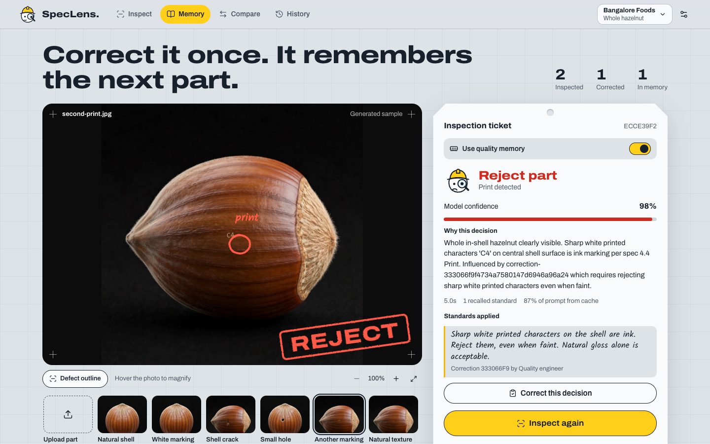
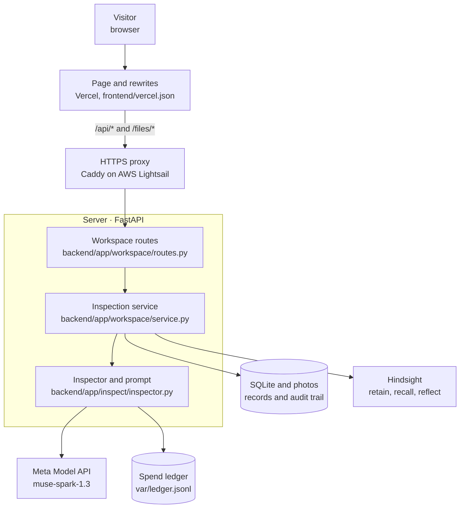
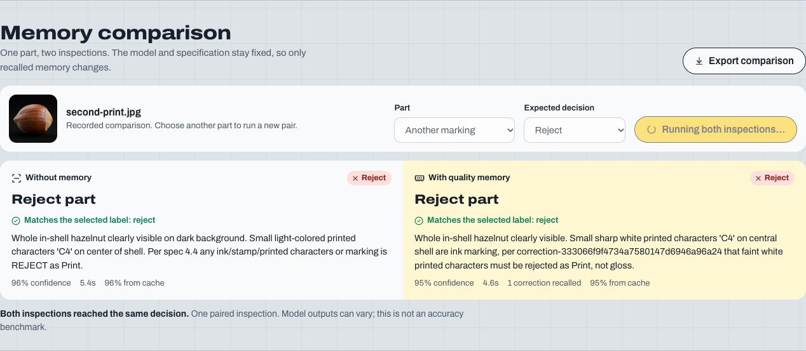
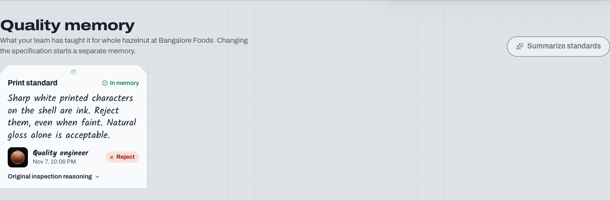
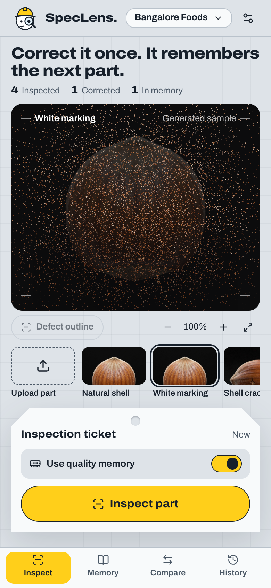

# SpecLens

**Team Vulcan**

- Aditya Arnav
- Pallab Das

Live link: [speclens.pallabdas.me](https://speclens.pallabdas.me/)

[](https://github.com/PDGamerSG/speclens/actions/workflows/ci.yml)

<p align="center">
  
</p>

A quality engineer should not have to explain the same inspection mistake twice. SpecLens checks a part photo against your specification, explains its decision, and marks any defect. When the decision is wrong, you correct it once. SpecLens remembers that standard and cites it when it checks the next part. It is for quality teams who inspect parts by eye and want each correction to count.

This repository holds the whole app: a one-page React interface, a FastAPI server that keeps the model and memory keys off the browser, SQLite records, synthetic sample parts with exact masks, automated tests, and the deployment setup for the public site.

## Features

| Feature | What it does |
| --- | --- |
| Inspect a part | Choose a sample or upload a photo. You get Accept, Reject, or Review, with the reason, the model's confidence, and a ring around any defect. |
| Correct a decision | Record the right decision and the visual rule to apply next time. The original model decision stays on record beside yours. |
| Quality memory | Saved corrections go to Hindsight. A later inspection recalls them and cites the correction it used. A failed save stays visibly pending and can be retried. |
| Memory comparison | Run the same photo with memory off and on, with the same model and specification, and compare the two decisions. |
| Photo checks | A photo that does not show the part gets Review, with what the photo shows and what a usable photo needs. |
| Inspection history | Search every inspection, reopen one, and export the full record as JSON. |
| Private workspaces | On the public site, a browser cookie keeps each visitor's records, photos, and memory apart. |

## How it works

A visitor picks a part photo, and the server sends it to the vision model with the specification and any standards recalled from memory.



Vercel serves the page. The browser calls relative `/api` and `/files` paths on that same origin, and Vercel rewrites them to the FastAPI server on AWS Lightsail, so the model and memory keys never reach the browser. The service recalls standards from Hindsight when memory is on, keeps only facts tied to a synced correction in that workspace, and passes them to the inspector. The inspector calls the vision model and records the cost in the ledger. The service saves the result in SQLite. A correction saves in SQLite first, then goes to Hindsight, so a failed memory write loses nothing. [The architecture notes](docs/ARCHITECTURE.md) have the component diagram, the request flow, and the data model.

### How memory is isolated

A Hindsight bank belongs to a normalized factory name, part family, and exact specification revision. A change to any of these starts a separate scope. Changing the base specification is explicit; saving a correction never rewrites it. Public mode also adds the browser's visitor identity to each scope.

When memory is on, a failed recall stops the inspection with a visible error. The app never substitutes a simulated result for a failed live request.

### Prompt caching

The Model API caches prompt prefixes, so the inspector sends stable content first: the instructions and specification, then the photo, then recalled memory. Recalled standards are sorted and deduplicated, so the same standards always produce the same bytes. One `prompt_cache_key` per specification keeps those requests together.

A paired comparison gains the most, because both arms share everything up to the memory block. In a live run, the two arms read 1,393 of 1,435 and 1,649 of 1,693 input tokens from cache. Moving memory out of the system message raised reuse on a repeated photo from 369 to 1,265 of 1,325 tokens. Each inspection shows its cache share, and **Workspace settings** shows the running total.

## Screenshots

Taken from the live site with real model and memory calls in headless Chromium, at 1440 × 900 with the light theme. The phone shot is 390 × 844. The pictured parts are synthetic examples.

<p align="center">
  
  <br><em>One part, two inspections. Only recalled memory changes.</em>
</p>

<table>
  <tr>
    <td width="50%"></td>
    <td width="50%"></td>
  </tr>
  <tr>
    <td><em>A saved correction, shown in the reviewer's handwriting style.</em></td>
    <td><em>On a phone, the first screen reaches the inspect button.</em></td>
  </tr>
</table>

## Tech stack

| Component | Purpose | License |
| --- | --- | --- |
| React 19 and Vite | One-page interface and build | MIT |
| TypeScript | Frontend types | Apache-2.0 |
| WebGL | Point cloud scan of the real photo, written without a library | Browser API |
| Lucide | Interface icons | ISC |
| Archivo and Kalam | Self-hosted fonts through Fontsource | OFL-1.1 |
| FastAPI | Server and validated routes | MIT |
| Uvicorn | Application server | BSD-3-Clause |
| SQLite | Inspection, correction, and comparison records | Public domain |
| Meta Model API, `muse-spark-1.3` | Vision decisions | Hosted service |
| Hindsight | Retain, recall, and reflect for quality memory | Hosted service |
| Vercel | Serves the interface and rewrites API and media requests to the server | Hosted service |
| AWS Lightsail | Runs the FastAPI server with its SQLite data and photos | Hosted service |
| Caddy | HTTPS proxy in front of the FastAPI server | Apache-2.0 |
| Playwright | Browser acceptance tests | Apache-2.0 |

## Quick start

You need Python 3.13 or [uv](https://docs.astral.sh/uv/), and Node.js 22.12 or later. If a step fails, see [the troubleshooting guide](docs/TROUBLESHOOTING.md).

```bash
git clone https://github.com/PDGamerSG/speclens.git
cd speclens
./scripts/setup.sh
```

The setup script builds the interface and creates a private, gitignored `.env`. Fill in the values listed in [the configuration guide](docs/CONFIGURATION.md):

```dotenv
MODEL_API_KEY=your-meta-model-api-key
MODEL_API_BASE_URL=https://api.meta.ai/v1
HINDSIGHT_BASE_URL=https://api.hindsight.vectorize.io
HINDSIGHT_API_KEY=your-hindsight-cloud-key
BUDGET_USD=5
DEMO_MODE=0
```

Use the Hindsight API endpoint for your account. A self-hosted Hindsight server can use its own URL and omit the key if authentication is disabled there.

```bash
./scripts/dev.sh
```

Open http://localhost:8770. For hot reload, run `./scripts/dev.sh --dev` and open http://localhost:5173. Override the API port with `SPECLENS_PORT` when needed, and restart the backend after changing credentials. Without credentials you can explore the workspace and samples, and live operations show a setup error.

Windows instructions are in [the setup guide](docs/setup.md).

To run with Docker instead:

```bash
cp .env.example .env
docker compose up --build -d
```

Add the server credentials to `.env` first, then open http://localhost:8770. The `speclens-data` volume holds SQLite, images, and the API spend ledger across restarts. The default local mode is a single-team workspace, so use a private network or an authenticated reverse proxy for remote team access.

### Checks

```bash
(cd frontend && npx playwright install chromium)
./scripts/check.sh
```

`scripts/check.sh` runs the build, lint, the Python tests, and the browser tests with live credentials disabled. CI runs the same steps from `.github/workflows/ci.yml` on pull requests and on pushes to `main`.

With both services configured and the app running, check the real integration. This makes billable vision calls and records the observed responses in a gitignored report:

```bash
.venv/bin/python scripts/system_check.py --base http://localhost:8770
```

To repeat the public browser check, which makes five vision calls:

```bash
node frontend/scripts/live-smoke.mjs
```

### Deploy

The live site has two parts. Vercel builds `frontend/` and publishes it from the connected GitHub repository, with the settings in `frontend/vercel.json`. The API, SQLite records, and photos stay on one AWS Lightsail server, with Docker Compose and Caddy. To update the server, `./scripts/deploy-speclens.sh` archives the current source, builds it there, and checks its health. Runtime credentials stay in a private server file, and `SPECLENS_ALLOWED_ORIGINS` lists the frontend origins the server accepts writes from. [The deployment guide](docs/deployment.md) covers access, publishing, backups, and recovery.

The public site allows 30 POST requests per browser per hour. A second limit of 120 per hour counts the visitor's IP address. The server accepts that address from Vercel only when `SPECLENS_PROXY_SECRET` matches on both sides. Without it, the limit counts the Vercel address, which visitors can share. Keep the same browser and cookies to revisit your history.

## Repository map

| Path | What it holds |
| --- | --- |
| `backend/app/workspace/` | SQLite records, Hindsight adapter, inspection service, validated routes |
| `backend/app/inspect/` | Vision prompt, output validation, defect localization |
| `backend/app/meta/` | Server-side model client, retries, cost ledger |
| `backend/app/forge/` | Image compositing, labels, and severity utilities |
| `backend/app/public.py` | Visitor cookie, request limits, and security headers |
| `frontend/src/workspace/` | One-page workspace: stage and point cloud scan, inspection ticket, quality memory, comparison, history |
| `frontend/vercel.json` | Vercel build settings, the API and media rewrites, and response headers |
| `fixtures/speclens/` | Synthetic white-print examples and exact masks |
| `tests/`, `frontend/tests/` | Backend regression tests and browser acceptance tests |
| `scripts/` | Setup, local run, checks, live checks, and deployment |
| `docs/` | Architecture, guides, evidence, and submission materials |

## Documentation

- [Documentation index](docs/README.md): every guide in one list.
- [Architecture](docs/ARCHITECTURE.md): how the parts fit together, the request flow, and the data model.
- [Configuration](docs/CONFIGURATION.md): every environment variable, its default, and what reads it.
- [User guide](docs/user-guide.md): each part of the page and what it does.
- [API](docs/api/README.md): the workspace routes.
- [Troubleshooting](docs/TROUBLESHOOTING.md): setup and deploy problems and their fixes.
- [Threat model](docs/security/threat-model.md): what the public site protects and how.
- [Test plan](docs/testing/test-plan.md): what each check covers.
- [Setup](docs/setup.md) and [deployment](docs/deployment.md): running it locally and on the server.
- [Verification record](docs/verification.md): observed results from live runs.
- [Demo walkthrough](docs/demo.md) and [submission materials](docs/submission/README.md).

## Known limits

- The included white-print images are synthetic test inputs with deterministic overlays. Their [manifest](fixtures/speclens/manifest.json) records provenance. They are not production validation data.
- A paired comparison is one observation from a stochastic model. It is not an accuracy benchmark. A [four-case live ablation](docs/evidence/memory-ablation.json) scored 3/4 decisions correctly without memory and 4/4 with memory, using only two held-aside source photos.
- An identical decoded image is marked as a reused correction image, but unknown near-duplicates still need manual exclusion from an independent evaluation.
- The current workflow covers one part family, with four fixed defect classes: hole, crack, cut, and print.
- Corrections are immutable. Use another inspection to add a further clarification.
- The page and the API are hosted apart, so the page can load while the one Lightsail server is down. Inspections then fail with a visible error.
- Local mode serves one team without sign-in. Public visitors are separated only by a browser cookie, so clearing cookies starts a new workspace.
- People remain responsible for disposition.

## License

No license file is recorded in this repository. See the [third-party notices](THIRD_PARTY.md) for dependency and data licenses.
