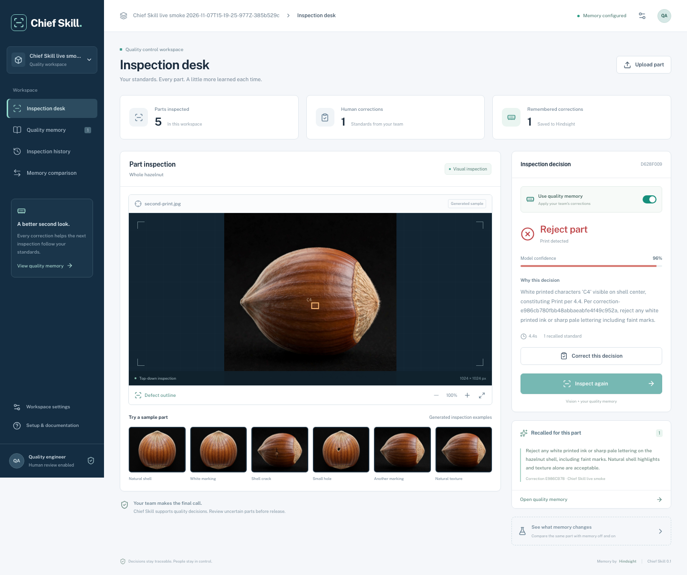
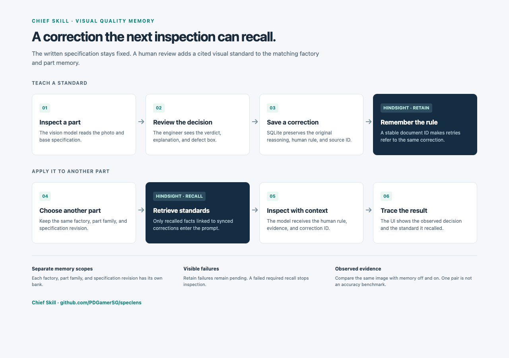

# SpecLens

[](https://github.com/PDGamerSG/speclens/actions/workflows/ci.yml)

**[Open the public demo](https://speclens.pallabdas.me)** · [Deployment guide](docs/deployment.md)

**Visual quality inspection that learns your factory’s standards.**

A quality engineer should not have to explain the same inspection mistake twice. SpecLens pairs vision with [Hindsight memory](https://hindsight.vectorize.io/): inspect a part, correct the decision, and recall that standard when checking the next part.

The public demo uses an HttpOnly cookie to keep each browser’s records and memory separate. Use the same browser and keep its cookies to revisit your history. It allows 30 POST requests per browser per hour and 120 per IP per hour.



*Actual public Meta/Hindsight inspection with its cited correction. The pictured part is a controlled synthetic example.*

## The workflow

1. Choose a sample or upload a part photo. Inspect with memory off to establish the model’s decision against the base specification.
2. Review the verdict, explanation, confidence, and defect box. Correct the decision and write the visual rule the inspector should apply.
3. SpecLens saves the original reasoning and your correction in SQLite, then calls Hindsight `retain`. Interrupted or failed writes remain visibly pending and can be retried.
4. Inspect a different part with memory on. Hindsight `recall` supplies relevant facts; the inspector receives only facts tied to a synced correction in this workspace, alongside its source rule and correction ID.
5. Open **Memory comparison** to inspect the same image twice, with and without recalled standards. Both arms use the same model and base specification. The interface records the observed decisions without assuming an improvement.

**Quality memory** also uses Hindsight `reflect` to summarize the team’s standards. History survives restarts, preserves the original model decision, and exports the complete workspace record as JSON.

## Run locally

Prerequisites: **Python 3.13+** or [uv](https://docs.astral.sh/uv/), and **Node.js 22.12+**. Tested on Python 3.13.

```bash
git clone https://github.com/PDGamerSG/speclens.git
cd speclens
./scripts/setup.sh
```

The setup script builds the interface and creates a private, gitignored `.env`. Set:

```dotenv
MODEL_API_KEY=your-meta-model-api-key
MODEL_API_BASE_URL=https://api.meta.ai/v1
HINDSIGHT_BASE_URL=https://api.hindsight.vectorize.io
HINDSIGHT_API_KEY=your-hindsight-cloud-key
BUDGET_USD=5
DEMO_MODE=0
```

Use the Hindsight API endpoint for your account. A self-hosted Hindsight server can use its own URL and omit the key if authentication is disabled there. The vision model is `muse-spark-1.3`.

```bash
./scripts/dev.sh
```

Open **http://localhost:8770**. For hot reload, run `./scripts/dev.sh --dev` and open http://localhost:5173. Override the API port with `SPECLENS_PORT` when needed. Restart the backend after changing credentials.

Without credentials, you can explore the real workspace and samples; live operations show a setup error. The app never substitutes a simulated result for a failed live request.

Windows instructions are in [the setup guide](docs/setup.md).

## Run with Docker

```bash
cp .env.example .env
# Add the server credentials to .env.
docker compose up --build -d
```

Open http://localhost:8770. The `speclens-data` volume holds SQLite, images, and the API spend ledger across restarts. The default local mode is a single-team workspace; use a private network or an authenticated reverse proxy for remote team access. The [public deployment](docs/deployment.md) uses the additional `compose.public.yaml` file to enable visitor isolation. See [setup and backup instructions](docs/setup.md).

## Prompt caching

The Model API caches prompt prefixes, so the inspector sends stable content first: the instructions and specification, then the photo, then recalled memory. Recalled standards are sorted and deduplicated, so the same standards always produce the same bytes. One `prompt_cache_key` per specification keeps those requests together, and it is shared across visitors because a cache hit needs an identical prefix.

A paired comparison gains the most, because both arms share everything up to the memory block. In a live run, the two arms read 1,393 of 1,435 and 1,649 of 1,693 input tokens from cache. Moving memory out of the system message raised reuse on a repeated photo from 369 to 1,265 of 1,325 tokens. Each inspection shows its cache share, and **Workspace settings** shows the running total.

## How memory is isolated



A Hindsight bank belongs to a normalized factory name, part family, and exact specification revision. A change to any of these starts a separate scope. Changing the base specification is explicit; saving a correction never rewrites it.

Public mode also includes the browser’s visitor identity in each memory and data scope. Clearing cookies or using a different browser profile starts a new visitor workspace.

SQLite holds the audit trail, pending writes, and the authoritative human correction. It does not replace Hindsight retrieval. When memory is enabled, a failed recall stops the inspection with a visible error. Recalled facts without a known, synced source correction are excluded from the prompt.

Server credentials stay on the backend. The browser uses relative `/api/workspace` routes. Runtime databases and ledgers are outside the public media mounts.

## Verification

```bash
# First time only, install the browser used by acceptance checks:
(cd frontend && npx playwright install chromium)
./scripts/check.sh
```

The single check command runs the same build, lint, Python, and browser checks as CI with live credentials disabled. The Python suite covers persistence, scope separation, HTTP validation, retry behavior, prompt construction, image reuse, and image-label integrity. Browser scenarios cover the full correction loop, mobile layout, interrupted sync, workspace isolation during requests, and historical comparisons. External vision and Hindsight calls are simulated in these automated tests.

With both services configured and the app running, verify the actual integration:

```bash
.venv/bin/python scripts/system_check.py --base http://localhost:8770
```

This makes billable vision calls, creates an isolated connection-check workspace, and records the observed responses in a gitignored report. It does not require the model to change its decision to pass the connection check.

## Evidence and limits

The included white-print images have deterministic overlays and exact changed-pixel masks. Their [manifest](fixtures/speclens/manifest.json) records provenance; `scripts/make_samples.py` regenerates them. They are synthetic test inputs, not production validation data.

A paired comparison is one observation from a stochastic model. An identical decoded image is marked as a reused correction image even if its metadata or filename changes. Bundled variants sharing a known source photo are also marked as reused. Unknown near-duplicate uploads and correlated variants still need manual exclusion from an independent evaluation. The [live integration check](docs/verification.md) confirms real Meta and Hindsight calls. Its first comparison rejected the marked part in both arms. A separate [four-case live ablation](docs/evidence/memory-ablation.json) scored 3/4 decisions correctly without memory and 4/4 with memory, with no false alarms on its two untouched controls. This exploratory result uses only two held-aside source photos and does not establish production accuracy.


Reproduce the small live probe with `.venv/bin/python scripts/evaluate_memory.py` while the configured app is running. It makes nine vision calls, creates its own workspace, excludes the teaching source photo, and records every paired response.

The current workflow covers one part family with human review. Local mode serves one team; public demo visitors have separate workspaces. Corrections are immutable; use another inspection to add a further clarification. People remain responsible for disposition. See [the demo walkthrough](docs/demo.md), [submission materials](docs/submission/README.md), and [dependency and data notices](THIRD_PARTY.md).

## Repository map

| Path | Responsibility |
|---|---|
| `backend/app/workspace/` | SQLite records, Hindsight adapter, inspection service, validated routes |
| `backend/app/inspect/` | Vision prompt, output validation, defect localization |
| `backend/app/forge/` | Image compositing, labels, and severity utilities |
| `backend/app/meta/` | Server-side model client, retries, cost ledger |
| `frontend/src/workspace/` | One-page workspace: stage and point-cloud scan, inspection ticket, quality memory, comparison, history |
| `fixtures/speclens/` | Synthetic white-print examples and exact masks |
| `tests/`, `frontend/tests/` | Backend regression and browser acceptance checks |
