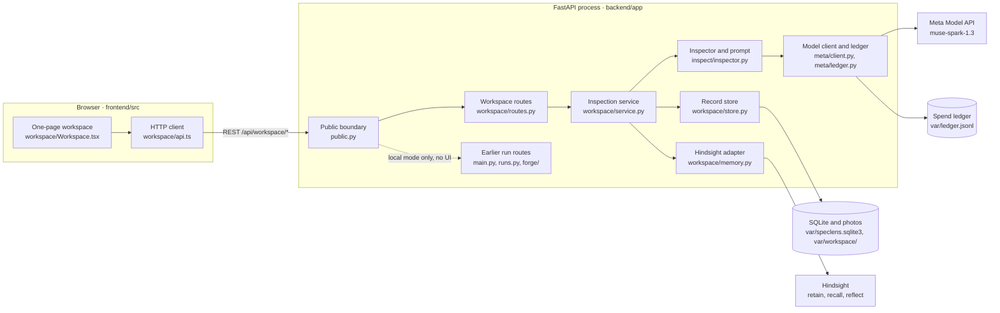
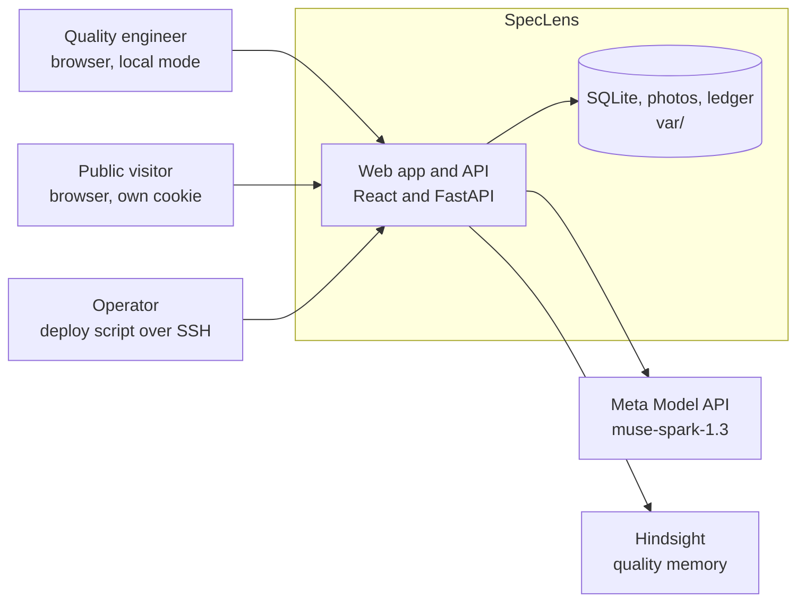
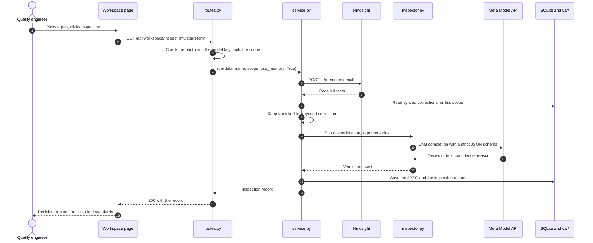
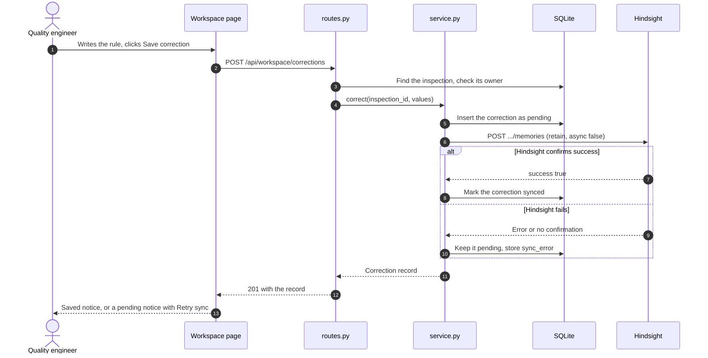
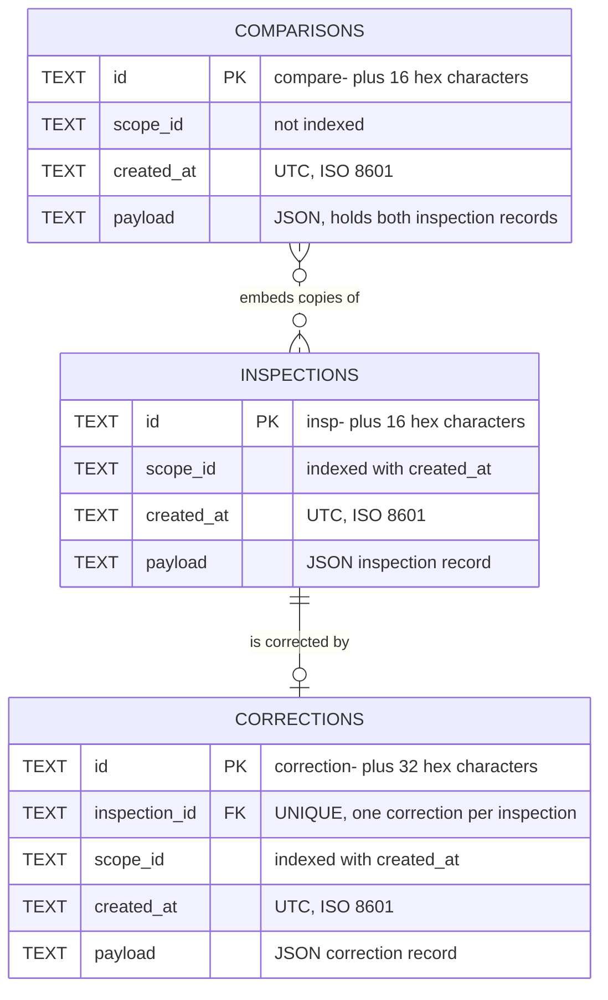
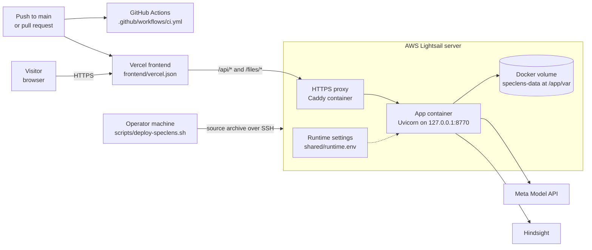

# Architecture

How the parts of SpecLens fit together, for anyone reading the code for the first time. The [README](../README.md) shows how to run it, [CONFIGURATION.md](CONFIGURATION.md) lists every setting, and [TROUBLESHOOTING.md](TROUBLESHOOTING.md) helps with setup problems.

SpecLens is one FastAPI process that serves a React page and a JSON API. A vision model checks a part photo against a specification. A person corrects a wrong decision, Hindsight keeps that correction, and later inspections recall it. SQLite holds the audit trail.

The server runs in one of two modes, chosen by `SPECLENS_PUBLIC` (`backend/app/public.py:19`):

- **Local mode** (`SPECLENS_PUBLIC=0`): one shared workspace with no sign-in.
- **Public mode** (`SPECLENS_PUBLIC=1`): a cookie gives each browser its own workspace, and the limits in `backend/app/public.py` apply. The [threat model](security/threat-model.md) covers this boundary.

Each part below has a status: **Implemented** (works end to end), **Partial** (code exists but the page does not use it), **Planned** (only the docs or the UI expect it) or **Not built** (no code, listed so nobody assumes it exists). Every diagram is followed by the files it was drawn from.

## The parts

Sources: `frontend/src/workspace/Workspace.tsx`, `frontend/src/workspace/api.ts`, `backend/app/main.py`, `backend/app/public.py`, `backend/app/workspace/routes.py`, `backend/app/workspace/service.py`, `backend/app/workspace/memory.py`, `backend/app/workspace/store.py`, `backend/app/inspect/inspector.py`, `backend/app/meta/client.py`, `backend/app/meta/ledger.py`.

- **`frontend/src/workspace/`**: the page, in React 19 and TypeScript, built with Vite (`frontend/package.json:7-18`). `Workspace.tsx` holds the page state. `api.ts` sends every API request, always to `/api/workspace` on the same origin (`frontend/src/workspace/api.ts:3-6`).
- **`backend/app/public.py`**: one middleware added in `backend/app/main.py:34`. In local mode it passes every request through (`backend/app/public.py:85-86`).
- **`backend/app/workspace/`**: `routes.py` validates input, `service.py` runs inspect, correct and compare, `memory.py` calls Hindsight over HTTP, and `store.py` reads and writes SQLite.
- **`backend/app/inspect/inspector.py`**: builds the prompt, defines the strict JSON reply, and turns the reply into a verdict.
- **`backend/app/meta/`**: `client.py` calls the Model API with server-side keys. `ledger.py` records the cost of each call and stops new calls past the budget (`backend/app/meta/ledger.py:54-56`).
- **SQLite**: one file at `var/speclens.sqlite3`, opened in WAL mode (`backend/app/workspace/routes.py:31`, `backend/app/workspace/store.py:50`). It needs no separate server.

| Folder | What it holds | Status |
| --- | --- | --- |
| `frontend/src/workspace/` | The page: viewer, ticket, correction form, memory, comparison, history, settings | Implemented |
| `frontend/src/components/` | `ErrorBoundary.tsx`, which shows a retry screen if the page crashes | Implemented |
| `backend/app/workspace/` | Routes, service, Hindsight adapter, SQLite store | Implemented |
| `backend/app/inspect/` | Prompt, reply schema, verdict rules | Implemented, except masks (see [what is not built yet](#what-is-not-built-yet)) |
| `backend/app/meta/` | Model API client, retries, cost ledger | Implemented |
| `backend/app/forge/` | Default specification (`backend/app/forge/spec.py:6`), plus the earlier synthetic defect pipeline | The default specification is Implemented. The pipeline is Partial |
| `backend/app/runs.py`, `backend/app/parts.py`, `backend/app/export/` | Earlier run engine, good-part library, COCO export | Partial |
| `fixtures/` | Sample photos, white-print masks, recorded replay data | Implemented |
| `scripts/` | Setup, run, checks, live checks, deployment | Implemented |
| `tests/`, `frontend/tests/` | Python tests and browser tests. See the [test plan](testing/test-plan.md) | Implemented |

## Context

Who uses SpecLens and which outside services it calls.

*C4 level 1, system context: SpecLens and the outside services it calls.*

Sources: `backend/app/config.py`, `backend/app/workspace/memory.py`, `backend/app/meta/client.py`, `scripts/deploy-speclens.sh`.

| Outside service | Data sent | When |
| --- | --- | --- |
| Meta Model API | System prompt with the specification, the photo as a JPEG up to 768 pixels on its long side, and any recalled standards | Each inspection (`backend/app/inspect/inspector.py:50-51`, `backend/app/inspect/inspector.py:59-68`). A comparison makes two calls |
| Hindsight, retain | Part family, factory, correction and inspection IDs, the model's original decision and reasoning, the reviewer's name, the corrected decision and the rule text | After a correction saves in SQLite (`backend/app/workspace/service.py:67`, `backend/app/workspace/memory.py:52-67`) |
| Hindsight, recall | A fixed question that names the part family | Before an inspection with memory on (`backend/app/workspace/service.py:27`, `backend/app/workspace/memory.py:72-76`) |
| Hindsight, reflect | A fixed request that names the part family and factory | When someone clicks **Summarize standards** (`backend/app/workspace/routes.py:206-208`, `backend/app/workspace/memory.py:91-95`) |

The page loads no outside scripts or fonts. Archivo and Kalam come from Fontsource packages in the build (`frontend/src/index.css:1-3`).

## Main request

What happens when someone inspects a part with memory on. This is the default, because the memory switch starts on (`frontend/src/workspace/Workspace.tsx:40`).

Sources: `frontend/src/workspace/Workspace.tsx:119-123`, `backend/app/workspace/routes.py:132-139`, `backend/app/workspace/service.py:24-53`, `backend/app/workspace/memory.py:72-89`, `backend/app/inspect/inspector.py:54-99`, `backend/app/meta/client.py:58-88`.

A failed recall stops the inspection with a 503 before any model call, so a result is never labeled memory-enabled without memory (`backend/app/workspace/service.py:26-27`, `backend/app/workspace/routes.py:95-96`). In public mode, the middleware checks the request first (see the [threat model](security/threat-model.md)).

## Correcting a decision

A correction saves in SQLite before it goes to Hindsight, so a failed memory write loses nothing.

Sources: `frontend/src/workspace/Workspace.tsx:124-130`, `backend/app/workspace/routes.py:165-175`, `backend/app/workspace/service.py:55-70`, `backend/app/workspace/store.py:97-117`, `backend/app/workspace/store.py:129-140`, `backend/app/workspace/memory.py:52-70`.

Each inspection takes one correction. The `UNIQUE` constraint on `inspection_id` turns a second attempt into a 409 (`backend/app/workspace/store.py:57`, `backend/app/workspace/store.py:115-116`, `backend/app/workspace/routes.py:174-175`). A retry reuses the correction ID as Hindsight's `document_id` with `update_mode: replace`, so retries refer to one document (`backend/app/workspace/memory.py:63`). A late failed retry cannot undo a synced correction (`backend/app/workspace/store.py:136-137`).

## How a verdict is decided

The model replies in a strict JSON schema (`backend/app/inspect/inspector.py:16-23`). The inspector then applies these rules (`backend/app/inspect/inspector.py:70-72`, `backend/app/inspect/inspector.py:88-95`):

| Model reply | Stored verdict | Shown as |
| --- | --- | --- |
| `part_visible` is false | `uncertain`, with any defect or box removed | Review |
| `defect` is false | `good` | Accept |
| `defect` is true | `defect` | Reject |

The labels come from `frontend/src/workspace/api.ts:48`. The workspace runs with masks off (`backend/app/workspace/service.py:40`), so in the workspace `uncertain` comes only from a photo that does not show the part.

Before the model call, the service applies EXIF rotation, converts the photo to RGB and hashes the pixels, then shrinks it to 1280 pixels on its long side (`backend/app/workspace/service.py:33-38`). The hash ignores metadata and file names, which lets a comparison notice a reused correction image (`backend/app/workspace/service.py:81-84`). It does not detect near-duplicates (`backend/app/workspace/service.py:36`).

## How memory is scoped

A scope is the factory, part family and specification. In public mode it also includes the visitor's owner ID (`backend/app/workspace/store.py:18-23`). The scope ID is the first 24 hex characters of a SHA-256 hash. Factory and part family are compared without case, and the specification must match exactly (`backend/app/workspace/store.py:32-38`).

Each scope has one Hindsight bank, named `speclens-<scope id>` (`backend/app/workspace/store.py:40-42`). Records in SQLite carry the same `scope_id`. Changing any scope field starts a separate memory and shows separate history, and nothing rewrites the base specification.

Recall can return facts from Hindsight, but the service passes on only facts whose `source_id` matches a synced correction in that scope (`backend/app/workspace/service.py:28-32`). The inspector labels them as evidence, not instructions (`backend/app/inspect/inspector.py:35-39`).

## How the prompt is built

The Model API caches prompt prefixes, so stable content comes first: the system prompt with the specification, then the photo, then the memory block (`backend/app/inspect/inspector.py:57-65`). The memory block is sorted and deduplicated, so the same standards produce the same bytes (`backend/app/inspect/inspector.py:43-47`). One `prompt_cache_key` per specification keeps those requests together (`backend/app/inspect/inspector.py:66-68`). Both arms of a comparison share everything up to the memory block.

A comparison runs the same photo twice, once without memory and once with it. The order follows the last hex digit of the comparison ID, so the same arm is not always first (`backend/app/workspace/service.py:74-80`).

## Data model

SQLite has three tables. Each row keeps its full record as JSON in `payload`. The other columns exist for lookups and constraints.

Sources: `backend/app/workspace/store.py:51-65`, `backend/app/workspace/service.py:42`, `backend/app/workspace/service.py:75`, `backend/app/workspace/store.py:101`.

The dashed line is not a foreign key. A comparison's `payload` holds full copies of its two inspection records (`backend/app/workspace/service.py:85-86`). Foreign keys are on for every connection (`backend/app/workspace/store.py:71`). A scope is not a table. It is a hash computed from its fields.

| Entity | Stored in | What the record holds |
| --- | --- | --- |
| Inspection | `inspections` table | Verdict, defect flag, type, confidence, rationale, box, time, cost, token counts, `part_visible`, scope fields, `owner_id`, image hash, file name, source fields, image URL and size, memory fields, `bank_id`, model (`backend/app/workspace/service.py:44-52`, `backend/app/inspect/inspector.py:96-99`) |
| Correction | `corrections` table | The original verdict, type and reasoning, the corrected verdict and defect class, the rule, the reviewer, scope fields, image hash and URL, `sync_status`, `sync_error` (`backend/app/workspace/store.py:101-110`) |
| Comparison | `comparisons` table | Baseline and memory inspections, expected verdict, `changed`, `held_out`, `reuse_reason`, a fixed note (`backend/app/workspace/service.py:85-90`) |
| Inspection photo | `var/workspace/<inspection id>.jpg` | The resized photo, saved as JPEG at quality 94. The original upload is not kept (`backend/app/workspace/service.py:43`) |
| Model call | `var/ledger.jsonl` | One JSON line per call: time, model, operation, duration, status, cost, token counts (`backend/app/meta/ledger.py:81-91`) |
| Quality memory | Hindsight bank for the scope | Retained corrections. Hindsight is the source of recall, and the rule text passed to the model comes from SQLite (`backend/app/workspace/store.py:1`, `backend/app/workspace/service.py:29-31`) |

## Deployment

Vercel serves the public frontend and deploys it from the connected GitHub repository. Same-origin rewrites proxy API and media requests to the existing AWS Lightsail service. An operator deploys that persistent backend with a script; GitHub Actions runs code checks independently.

Sources: `frontend/vercel.json`, `scripts/deploy-speclens.sh`, `compose.yaml`, `compose.public.yaml`, `Dockerfile`, `.github/workflows/ci.yml`.

- **Build:** the `Dockerfile` builds the page with Node 22, then copies it into a Python 3.13 image that runs as a non-root user (`Dockerfile:1-6`, `Dockerfile:8`, `Dockerfile:16-18`). Its health check calls `/api/workspace/status` (`Dockerfile:21`).
- **Ports:** Compose binds the app to `127.0.0.1:8770` on the host (`compose.yaml:5`). Only Caddy faces the internet.
- **Public settings:** `compose.public.yaml` sets `SPECLENS_PUBLIC=1` and `FORWARDED_ALLOW_IPS=*` (`compose.public.yaml:5-7`).
- **Release steps:** the script archives the working tree without `.env`, Git history or runtime data (`scripts/deploy-speclens.sh:85-91`). On the server it extracts a release, links the settings file as `.env`, and starts Compose with both files under the project name `chief-skill` (`scripts/deploy-speclens.sh:124-127`). It waits for `/api/workspace/status`, then moves the `current` link (`scripts/deploy-speclens.sh:128-140`).
- **Publishing:** `--publish` writes a Caddyfile, starts a Caddy container on the host network, and opens ports 80 and 443 (`scripts/deploy-speclens.sh:141-162`, `scripts/deploy-speclens.sh:166-170`).

[The deployment guide](deployment.md) covers server access, backups and recovery.

## What is not built yet

| Part | Status | Evidence |
| --- | --- | --- |
| Synthetic defect pipeline: runs, stress tests, COCO export | Partial. The routes work in local mode, the page never calls them, and public mode returns 404 | `backend/app/main.py:91-164`, `frontend/src/workspace/api.ts:3`, `backend/app/public.py:93-95` |
| SAM 3.1 defect masks | Partial. `inspect()` supports masks, and the workspace turns them off | `backend/app/inspect/inspector.py:84-87`, `backend/app/workspace/service.py:40` |
| `POST /api/workspace/recall` in the page | Partial. `api.ts` defines the call but no component uses it. `scripts/system_check.py` uses the route | `frontend/src/workspace/api.ts:38`, `scripts/system_check.py:64` |
| Evaluation report | Partial. `/api/eval` reads `docs/results/eval.json` and names `eval/run_eval.py`. Neither file is in the repository | `backend/app/main.py:207-213`, `backend/app/config.py:21` |
| More than four defect classes | Not built. The classes are fixed in the service and the correction route | `backend/app/workspace/service.py:39`, `backend/app/workspace/routes.py:145` |
| Editing or deleting records | Not built. The store has no update for a saved rule and no delete, and the routes offer neither | `backend/app/workspace/store.py:78-151`, `backend/app/workspace/routes.py:103-218` |
| Accounts, roles and team administration | Not built, by design | `docs/design.md:22` |
| More than one server process | Not built. The request limiter lives in process memory, and the container starts one Uvicorn process | `backend/app/public.py:25`, `Dockerfile:22` |
