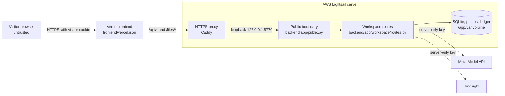

# Threat model

What data SpecLens handles, where it goes, and how it is protected. Most of the protection lives in `backend/app/public.py` and applies only in public mode (`SPECLENS_PUBLIC=1`). The live site runs in public mode (`compose.public.yaml:5`).

The site has no accounts and takes no payments. It holds two API keys, and it sends visitors' photos to an outside model. The main risks are a visitor reading another visitor's data, someone running up the provider bill, and a key leaking.

## Data the site handles

"Owner" below means the browser that holds the visitor cookie. In local mode there is no owner, so anyone who can reach the server can read everything.

| Data | Stored in | Sent to | Who can read it |
| --- | --- | --- | --- |
| Part photo | `var/workspace/<id>.jpg`, re-encoded at up to 1280 pixels. The original file is not kept, and EXIF metadata does not survive re-encoding (`backend/app/workspace/service.py:33-43`) | Meta Model API, as a JPEG up to 768 pixels (`backend/app/inspect/inspector.py:50-51`) | Owner (`backend/app/main.py:223-233`) |
| Upload file name | Inspection record (`backend/app/workspace/routes.py:67`, `backend/app/workspace/service.py:47`) | Not sent | Owner |
| Factory, part family, specification | Inspection record, and browser local storage | Specification to Meta. Factory and part family to Hindsight (`backend/app/inspect/inspector.py:26-40`, `backend/app/workspace/memory.py:53`) | Owner |
| Model decision and reasoning | SQLite | Reasoning to Hindsight, with a correction (`backend/app/workspace/memory.py:55-56`) | Owner |
| Correction rule and reviewer name | SQLite. The reviewer name is also in browser local storage (`frontend/src/workspace/CorrectionForm.tsx:18`) | Hindsight. The rule also goes to Meta when recalled (`backend/app/workspace/memory.py:57-59`, `backend/app/inspect/inspector.py:43-47`) | Owner |
| Visitor token | Browser cookie only. The server stores its SHA-256 hash as `owner_id` (`backend/app/public.py:91-93`) | Not sent | The browser that holds it |
| Client IP address | Process memory for up to an hour (`backend/app/public.py:51-64`), and Uvicorn's default access log | Not sent | Server operator |
| Model call log | `var/ledger.jsonl` (`backend/app/meta/ledger.py:13`) | Not sent | Server operator. `/api/ledger` returns 404 in public mode |
| API keys | `.env`, or `/opt/chief-skill/shared/runtime.env` on the server | Each key goes only to its own provider | Server operator |

How long Meta and Hindsight keep this data is not recorded in the repository.

## Trust boundaries

Sources: `scripts/deploy-speclens.sh:148-161`, `compose.yaml:5`, `compose.public.yaml`, `backend/app/public.py`, `backend/app/workspace/routes.py`, `backend/app/meta/client.py:24-25`, `backend/app/workspace/memory.py:26`.

## Visitor workspaces

Public mode separates visitors with one cookie, and no sign-in.

- **Token:** a first visit gets a random 64-character hex token from `secrets.token_hex(32)`. A cookie that does not match that shape is ignored (`backend/app/public.py:29`, `backend/app/public.py:91`).
- **Cookie:** `speclens_workspace`, `HttpOnly`, `SameSite=Lax`, and `Secure` over HTTPS (`backend/app/public.py:117-118`). It lasts 30 days from the last API visit, because each API response renews it (`backend/app/public.py:115`).
- **Owner ID:** the server hashes the token with SHA-256 and uses the hash as `owner_id` (`backend/app/public.py:93`). Records and JSON exports contain the hash, never the cookie value. The hash cannot be used as a cookie (`tests/test_public_workspace.py:130-137`).
- **Scope:** `owner_id` is part of the scope hash, so two visitors with the same factory name get different records and different Hindsight banks (`backend/app/workspace/store.py:32-42`).
- **Direct IDs:** routes that take an ID check the owner, and return 404 on a mismatch, so a visitor cannot confirm that another visitor's record exists (`backend/app/workspace/routes.py:167-169`, `backend/app/workspace/routes.py:180-182`, `backend/app/main.py:227-229`).
- **Legacy cookie:** a valid `chief_skill_workspace` cookie keeps its identity under the new name, and the old cookie is deleted (`backend/app/public.py:90-91`, `backend/app/public.py:119-120`).

## Request limits

| Limit | Value | Where |
| --- | --- | --- |
| POST requests per browser | 30 per hour | `backend/app/public.py:20-21`, `backend/app/public.py:59` |
| POST requests per visitor IP address | 120 per hour. The address comes from `x-real-ip` only with a matching `SPECLENS_PROXY_SECRET` (`backend/app/public.py:36-48`). Otherwise it is the connecting address. One IPv6 /64 counts as one visitor | `backend/app/public.py:59` |
| Request body | 9 MiB, checked on the declared size and while streaming | `backend/app/public.py:24`, `backend/app/public.py:73-82`, `backend/app/public.py:109-114` |
| Photo | 8 MiB, 25 megapixels, JPEG, PNG or WebP, still images only | `backend/app/workspace/routes.py:27`, `backend/app/workspace/routes.py:71-83` |
| Text | Factory and part 100 characters, specification 12,000, rule 2,000 | `backend/app/workspace/routes.py:51`, `backend/app/workspace/routes.py:146` |
| Vision spend | `BUDGET_USD`, across all visitors | `backend/app/meta/ledger.py:54-56`, `backend/app/meta/client.py:62` |

The IP limit exists because the browser limit is easy to reset: dropping the cookie creates a new visitor (`tests/test_public_workspace.py:119-127`).

## Response headers

Public mode adds these to every response (`backend/app/public.py:121-131`).

| Header | Value |
| --- | --- |
| `X-Content-Type-Options` | `nosniff` |
| `Referrer-Policy` | `same-origin` |
| `X-Frame-Options` | `DENY` |
| `Cache-Control` | `no-store` on `/api/` and `/files/workspace/` only |
| `Content-Security-Policy` | See below |

| CSP directive | Value | Effect |
| --- | --- | --- |
| `default-src` | `'self'` | Anything not listed comes from the same origin only |
| `script-src` | `'self'` | No inline or outside scripts |
| `style-src` | `'self' 'unsafe-inline'` | Allows inline styles |
| `font-src` | `'self'` | Same-origin fonts only. Fontsource bundles them |
| `img-src` | `'self' blob: data:` | `blob:` previews a chosen upload (`frontend/src/workspace/Workspace.tsx:81`) |
| `connect-src` | `'self'` | The page can call only its own origin |
| `object-src` | `'none'` | No plugins |
| `base-uri` | `'self'` | Blocks a changed base URL |
| `frame-ancestors` | `'none'` | No site can frame the page |
| `form-action` | `'self'` | Forms submit only to this origin |

## Risks and mitigations

**Implemented** means the code covers the risk. **Partial** means it reduces the risk and leaves a gap. **Open** means nothing covers it yet. **Accepted** means the behavior is intended.

| Risk | Where | Mitigation | Status |
| --- | --- | --- | --- |
| A visitor reads another visitor's records or photos | `backend/app/workspace/routes.py:117-122`, `backend/app/main.py:223-233` | Owner ID in the scope hash, owner check on each ID route. Tested in `tests/test_public_workspace.py:21-34` | Implemented |
| A visitor changes another visitor's memory | `backend/app/workspace/store.py:32-42` | One Hindsight bank per scope, with the owner in the scope. Tested in `tests/test_public_workspace.py:37-53` | Implemented |
| A stolen cookie gives access to a workspace | `backend/app/public.py:117-118` | `HttpOnly`, `Secure` and `SameSite=Lax`. The cookie is still a bearer token, and the server cannot revoke one | Partial |
| Another site makes a visitor's browser write | `backend/app/public.py:99-105` | Writes with a foreign `Origin` return 403, and `SameSite=Lax` holds the cookie back on cross-site POSTs. A request with no `Origin` header passes this check, but a browser form post from another site has one | Implemented |
| Someone runs up the Model API bill | `backend/app/public.py:51-64`, `backend/app/meta/ledger.py:54-56` | Request limits and a persisted budget. A comparison makes two vision calls, so it counts as two requests. The guard checks spend before a call, so calls in progress can pass it (`docs/setup.md:15`) | Partial |
| One visitor uses up the budget for everyone | `backend/app/meta/ledger.py:54-56` | The budget is global, with no per-visitor share. The request limits slow this down. Once the budget is reached, all visitors get 402 | Open |
| Someone runs up the Hindsight bill | `backend/app/workspace/memory.py` | Request limits only. `BUDGET_USD` does not cover Hindsight | Open |
| Limits reset or split | `backend/app/public.py:27` | Limits live in process memory. A restart clears them, and they would not be shared across several processes. The image runs one (`Dockerfile:22`) | Partial |
| A hostile upload, such as a decompression bomb or an oversized stream | `backend/app/workspace/routes.py:59-84`, `backend/app/public.py:73-82` | Size, format, animation and pixel checks before any model call, and a streaming body cap. Tested in `tests/test_public_workspace.py:140-160` and `tests/test_workspace_api.py:51-68` | Implemented |
| Path traversal through `sample_id` or a file name | `backend/app/workspace/routes.py:61`, `backend/app/workspace/routes.py:67`, `backend/app/main.py:225-230` | Samples come from a fixed list, upload names keep only the base name, and photo paths come from a looked-up inspection ID. Tested in `tests/test_workspace_api.py:71-73` | Implemented |
| Download of the database, ledger or other private files | `backend/app/main.py:214-221`, `backend/app/public.py:95-98` | The `var` root is never mounted. Each media folder is mounted on its own, and public mode allows only fixtures and owner-checked photos. Tested in `tests/test_public_workspace.py:97-104` and `tests/test_workspace_api.py:94-103` | Implemented |
| Abuse of the earlier expensive routes | `backend/app/public.py:95-98` | Public mode returns 404 for them. Tested in `tests/test_public_workspace.py:56-60` | Implemented |
| Information shown to anyone | `backend/app/public.py:95`, `backend/app/main.py:31`, `backend/app/workspace/routes.py:103-108` | `/api/health` and `/api/workspace/status` show spend and budget, but no key or record. Public mode returns 404 for `/docs`, `/redoc` and `/openapi.json` | Accepted |
| Script injection into the page | `frontend/src/workspace/`, `backend/app/public.py:126-129` | React escapes model and user text, and `frontend/src` uses no `dangerouslySetInnerHTML`. The CSP blocks inline scripts | Implemented |
| Clickjacking | `backend/app/public.py:123-129` | `X-Frame-Options: DENY` and `frame-ancestors 'none'` | Implemented |
| Prompt injection through a photo, specification or rule | `backend/app/inspect/inspector.py:35-39`, `backend/app/inspect/inspector.py:16-23` | The prompt calls recalled records evidence, not instructions. The reply must fit a strict schema, the model has no tools, and people make the final call. A crafted input can still mislead the decision, but in public mode only inside the visitor's own workspace | Partial |
| An API key reaches the browser | `backend/app/workspace/routes.py:103-108`, `frontend/vite.config.ts:7` | Keys stay in server variables. The API reports only whether each is set, and no setting enters the page build | Implemented |
| A key leaks through a deployment | `scripts/deploy-speclens.sh:85-99`, `.dockerignore:2` | See [keys and secrets](#keys-and-secrets) | Implemented |
| A client forges forwarded headers | `compose.public.yaml:7`, `compose.yaml:5` | Uvicorn trusts all forwarded headers, so only the proxy may reach it, and the host port stays on loopback. The Caddyfile has no forwarded header settings, so this relies on Caddy's default behavior, which the repository does not test | Partial |
| HTTPS downgrade | `scripts/deploy-speclens.sh:148-152`, `backend/app/public.py` | Caddy serves HTTPS, the cookie is `Secure`, and HTTPS responses carry `Strict-Transport-Security` | Mitigated |
| Local mode exposed to a network or a malicious page | `backend/app/main.py:32`, `scripts/dev.sh:22`, `compose.yaml:5` | Local mode has no sign-in. It sends no CORS headers, so another website cannot read its responses, but a page open on the same machine can still send it a simple form post. It binds to `127.0.0.1` only. For remote access, `docs/setup.md:41` calls for an authenticated HTTPS proxy | Accepted |
| Personal data kept with no end date | `backend/app/workspace/store.py:78-151` | There is no delete route and no expiry. Photos, records and reviewer names stay until an operator removes them, including those from expired cookies | Open |

One small item for the next review:

- `style-src` keeps `'unsafe-inline'`. The tests do not check whether the page needs it. `tests/test_public_workspace.py:104` asserts only `X-Content-Type-Options`.

## Keys and secrets

SpecLens holds three secrets: `MODEL_API_KEY`, `HINDSIGHT_API_KEY` and `SPECLENS_PROXY_SECRET`. [The configuration guide](../CONFIGURATION.md#secrets) says where to get them.

- **Local:** they live in `.env`, which `scripts/setup.sh` limits to your user (`scripts/setup.sh:25-26`). Git, Docker builds and the deploy archive all exclude it (`.gitignore:2`, `.dockerignore:2`, `scripts/deploy-speclens.sh:86`).
- **Server:** the deploy script streams the file over SSH without logging it, into `/opt/chief-skill/shared/runtime.env`, owned by root with mode `0600` (`scripts/deploy-speclens.sh:94-99`, `scripts/deploy-speclens.sh:116-119`).
- **Runtime:** only the server reads them (`backend/app/config.py:13`, `backend/app/workspace/routes.py:32`). The Model API key goes to `MODEL_API_BASE_URL`, and the Hindsight key to `HINDSIGHT_BASE_URL` as a bearer token.
- **Live checks:** `frontend/scripts/live-smoke.mjs` saves a browser session under `var/checks/` with mode `0600`, and redacts cookie values from its messages (`frontend/scripts/live-smoke.mjs:85-94`). That file is a credential. Keep it private.

To rotate a key:

1. Create the new key with the provider.
2. Local: edit `.env` and restart the server.
3. Server: update your settings file and run `./scripts/deploy-speclens.sh --env-file <file>`.
4. Revoke the old key with the provider.
5. Check the connection with `scripts/system_check.py` (billable).

Rotating a key does not affect visitor workspaces. Visitor cookies do not depend on either key.
