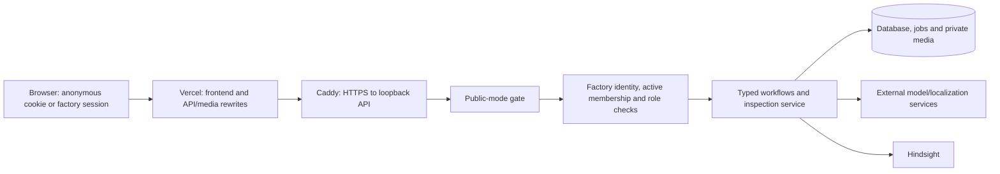

# Threat model

SpecLens serves an anonymous inspection demo and a signed-in factory workspace. It sends photo/specification evidence to outside model services and selected quality standards to Hindsight. The principal risks are cross-team disclosure, stolen credentials, unauthorized teaching/disposition, misleading evidence and provider-cost abuse.

Factory authentication, membership, roles and record ownership apply with public mode on or off. Public mode (`SPECLENS_PUBLIC=1`) additionally isolates anonymous visitors, restricts legacy routes, limits requests and adds response headers. With public mode off the anonymous development interface remains shared; it is not a private team workspace merely because the factory sign-in screen exists.

## Data and recipients

"Owner" means an anonymous visitor identity in public mode or the signed-in team ID. Team membership permits reading that team's operational records; there is no per-lot secrecy between active members.

| Data | Persistence/recipient | Access and limits |
| --- | --- | --- |
| Photos, masks, overlays and corrected-region crops | Local media folder or configured private R2 bucket; photo/reference crops to the model and localization services | Owner-checked `/files/workspace/` URLs; fixtures are intentionally public. Saved inspection photos are re-encoded; original queued uploads may exist until job cleanup |
| Factory/product/specification, taxonomy, setup and capture context | Database; specification, image and eligible recalled rules to inspection providers | Same-team records; approved recipe snapshots do not follow later display-name edits |
| Model outputs, human dispositions and proposed standards | Database; approved correction material to Hindsight and eligible recalled rules/crops to later model calls | Model output and human decision remain separate; factory candidates cannot teach until approval |
| Display names, usernames, teams and memberships | `pilot_users`, `pilot_teams`, `pilot_memberships` | Usernames are unverified local identifiers, not verified email or enterprise identity. Members read operational actors; only admins list/manage membership |
| Passwords | Salted scrypt hash in database, not plaintext | Server operator/database backup access remains sensitive; there is no reset/recovery/change/MFA/SSO flow |
| Session/invitation tokens | Raw bearer value in cookie or once-returned invitation; only SHA-256 hash in database | Seven-day sessions; 48-hour one-use invitations; share neither in logs/screenshots/exports |
| IP/address and username attempt counters | Hashed keys and time-window counts in `pilot_auth_limits`; access logs may record connecting IP | Auth limits do not depend on the demo cookie and survive process restart |
| Operational activity, issue history and validation manifests | Team-owned database JSON | Application-enforced immutable events/runs; privileged database operators can still alter state |
| Model spend/usage | Durable database budget/call records and compatibility ledger files | Global budget rather than a guaranteed per-team share; public status exposes totals, not credentials |
| Model, memory, proxy and configured storage/monitoring secrets | Private runtime environment/provider requests | Server-side only; no browser build variables. Optional error monitoring has its own processing/retention |

The repository does not establish Meta, Hindsight or other configured providers' retention periods. Local deletion or restoring a backup does not erase remote provider logs or backups. Review provider configuration separately for the material being inspected.

## Trust boundaries

The database, application host, deploy access and runtime environment are trusted administrative boundaries. No application guarantee protects records against a malicious database administrator. Model results and imported validation labels/provenance are untrusted inputs to human decisions.

## Factory accounts and ownership

Passwords use scrypt (`n=16384`, `r=8`, `p=1`) with a fresh 16-byte salt and constant-time verification. Password length is 12–256 characters for new accounts. Username uniqueness is case-insensitive. Registration makes an isolated team/admin; it cannot select another existing team's ID.

`speclens_session` is a random opaque token, HttpOnly, SameSite=Strict, Secure over HTTPS, path `/`. The server stores a SHA-256 token hash and a seven-day expiry. Logout revokes the current session. Every authenticated read resolves current active membership and role, including existing inspection, history, job, media and export paths. Invalid/expired/revoked cookies fail with 401; they do not become anonymous permission to team data.

Invitation tokens are random, hashed at rest, returned once, expire after 48 hours and are consumed atomically. A concurrent/repeated redemption cannot create a second member. Invitations create new username accounts and do not verify the recipient's real identity or email. An admin's private sharing procedure remains part of access control.

Admins manage membership and publish revisions/standards. Engineers manage setup, human reviews, standard proposals, issues and validation imports. Operators capture/open lots; viewers read. Deactivation revokes that member's team sessions. Reactivation requires sign-in again; role changes apply to existing sessions. A transaction/lock prevents removing the final active admin. Keep a second trusted admin; there is no self-service account recovery or delegated password reset.

Team ownership is stable across mutable product/factory labels. Same-team, correct-kind references and optimistic versions prevent cross-team joins and silent lost updates. Pilot record identity is scoped by `(owner_id,id)`. API bodies cannot override server IDs, ownership or reviewer/claim actors. Internal repository calls are not an authorization boundary: trusted service callers must preserve these rules.

## Anonymous demo boundary

Public mode issues `speclens_workspace`, a random 32-byte hex token, HttpOnly, SameSite=Lax and Secure over HTTPS, renewed for 30 days on API use. Its SHA-256 hash is the stored owner, not a reusable cookie credential. A valid legacy `chief_skill_workspace` cookie preserves the same identity during migration. Clearing cookies or changing hostname/profile starts another demo workspace.

Anonymous cookies do not grant factory membership. While signed in, team ownership takes precedence on old workspace endpoints. Returning to the demo signs out. A stolen anonymous cookie remains a bearer credential without the factory session's server-side revocation/expiry model. Keep anonymous exports private as well.

## Request, origin and cost controls

| Control | Implemented behavior |
| --- | --- |
| Independent account limits | Registration/login/join: 15-minute database windows, 80 combined attempts/address, 40/action/address, 12/action/username; successes and failures count; 429/Retry-After |
| Public demo quota | Non-factory POSTs except rule parsing: 30/browser/hour and 120/address/hour; comparisons cost two. Factory routes under `/api/workspace/pilot/` are exempt from this demo quota |
| Shared demo limiter | Configured Redis shares limits across instances; otherwise process-memory demo counters reset on restart. Account counters remain database-backed |
| Trusted visitor IP | `x-real-ip` accepted only with matching `SPECLENS_PROXY_SECRET`; otherwise count connecting address. IPv6 uses /64 grouping |
| Origin/CSRF | Factory writes require same origin or an exact configured `SPECLENS_ALLOWED_ORIGINS` with matching scheme; cross-site Fetch Metadata rejected. SameSite cookies supplement this guard. Non-browser requests without Origin still need credentials |
| Uploads | Still JPEG/PNG/WebP, ≤8 MiB and ≤25 megapixels; format/decompression checks before inference. Public request bodies limited to 9 MiB including streaming |
| Provider cost | Persisted global vision budget and request/job controls. Hindsight billing is separate. Registered teams have no guaranteed private share of the global budget |

Vercel can rewrite the request Host to the backend hostname. Configure the exact HTTPS frontend origins; do not authorize arbitrary suffixes/forwarded hosts. The app trusts forwarded HTTPS metadata only because deployment binds the API to `127.0.0.1:8770` behind the trusted proxy. Incorrect exposure of that port/forwarded headers is an operational risk, not fixed by session hashing.

Public mode and the frontend set `nosniff`, frame restrictions, a same-origin referrer policy, and a CSP that restricts scripts/connections to the same origin. Public API and workspace-media responses are `no-store`; factory account/workflow routes and lot downloads also request no-store directly. CSP retains `style-src 'unsafe-inline'`. React escapes user/model text; these measures reduce browser attacks but do not make stolen sessions or hostile extensions harmless.

## Governance and evidence integrity

| Risk | Control and remaining limit |
| --- | --- |
| Wrong or malformed recipe used for inference | Admin approval validates complete taxonomy, bounded text and finite dimensions, then freezes the revision. Human confirmation can still be wrong; setup records do not calibrate hardware |
| Unauthorized or stale teaching | Factory corrections begin as candidates. Only approved current standard versions for the exact team/revision enter retain/recall/crops/summary. Retirement blocks new use locally even if a remote fact remains |
| Withdrawal during an active provider call | Context/source versions are rechecked, the assessment/provenance is saved and the review/capture quarantined. Historical evidence is preserved rather than rewritten as current |
| Retry/recovery duplicates or changes evidence | Stable capture identity binds pixels/context to a deterministic saved assessment/review. Different physical items still depend on correct operator IDs; unknown near-duplicates are not automatically proved independent |
| Premature lot closure | Pending/failed captures and open reviews block closure. All older reviews must close; hold/retake/quarantine need validated linked replacements, and latest physical disposition must resolve. Software closure is not permission to release material |
| Silent lost review edits or unaudited mutation | Compare-and-swap versions return 409; events share the mutation transaction. Activity is lifecycle history, not tamper-proof security auditing or a digital signature |
| Misleading validation results | Immutable input/configuration manifests, explicit truth denominators, Review/error and connected lot/session cluster limitations. Supplied outputs, labels, first-attempt order, IDs and leakage claims are not independently verified |
| Misleading evidence export | Complete team-scoped lot JSON/CSV, explicit part/attempt/assessment counts, missing-media flags and file hashes. JSON does not embed images or authenticate an importer's source |
| CSV formula execution | Report text cells that could begin spreadsheet formulas are escaped. Consumers still control how exported files are handled |
| Prompt injection | The model has no application tools, output is schema-checked and human review remains required. A hostile photo/spec/rule may still mislead a model; approval and role controls do not establish semantic truth |

## Retention, erasure and backups

Anonymous operational evidence is eligible for the nightly `RETENTION_DAYS` purge, **90 days by default**, together with linked media and memory documents. Demo-cookie expiry and record retention are different clocks. Finished technical jobs/uploads can be cleaned after seven days.

Factory operational records, inspections and their evidence media are excluded from that anonymous age purge. They remain beyond 90 days and beyond session expiry or membership deactivation, until explicit administrative deletion. This deliberate durability requires a team/operator retention decision; it is not an automatically compliant retention schedule.

An admin may call `DELETE /api/workspace/data` with `{"confirm":"DELETE"}` after active jobs finish. Configured Hindsight banks are removed first; remote failure preserves local records for retry. Local cleanup removes operational pilot records and related workspace records/media/jobs, with failures surfaced in response counts/logs. Check those results. This leaves users, teams, memberships, sessions, invitations and auth counters intact. There is no complete account-erasure API.

Exports contain private record and actor data. Media URLs require a current active team session; bytes are not embedded. Digests identify downloaded evidence but are not access tokens, signatures or a promise of permanent availability. Backups retain authentication hashes and operational history and require their own access/retention controls. A local delete does not remove copies someone exported or provider-side retained data.

Migration 0003 is additive. Take and verify a consistent database/media backup before the new engine starts, preserve counts/schema/source identity, and restore only matching snapshots on recovery. Do not use downgrades, table deletion or volume deletion as a release rollback. See the [deployment runbook](../deployment.md#factory-workspace-release-migration-and-retention).

## Secrets and remaining operational limits

Local `.env`, the server's root-owned mode-0600 `/opt/chief-skill/shared/runtime.env`, and SSH/deployment credentials remain outside Git, Docker builds and frontend bundles. Provider keys are sent only to their configured services. `SPECLENS_PROXY_SECRET` authenticates the visitor-address assertion, not a user's identity. Optional R2/Sentry secrets need the same handling. Browser automation storage-state files are credentials; keep them private and redact cookies from reports.

Rotate provider credentials through the saved runtime configuration, restart the affected service and revoke old keys at the provider. Key rotation does not revoke local factory sessions or anonymous cookies; membership deactivation/logout control factory access. Account compromise, password recovery and full identity erasure currently require operator work outside the app and should not be represented as implemented product flows.

The API host/database and remote providers remain trusted. There is no encrypted-field store, independent tamper-evident log, enterprise identity integration or verified-email assurance. Public registration plus global model budget also leaves availability/cost contention between teams. An application test suite establishes software behavior; representative permissioned parts, measurement controls and accountable quality review are still needed for factory performance claims.

Implementation references: [auth](../../backend/app/pilot/auth.py), [schema](../../backend/app/pilot/tables.py), [workflow API](../../backend/app/pilot/routes.py), [repository](../../backend/app/pilot/store.py), [capture governance](../../backend/app/pilot/integration.py), [lot resolution](../../backend/app/pilot/resolution.py), [reports](../../backend/app/pilot/reports.py), [validation](../../backend/app/pilot/validation.py), [public boundary](../../backend/app/public.py), and the [factory API reference](../api/factory.md). Offline security/lifecycle coverage is in `tests/test_pilot.py`, `tests/test_pilot_integration.py` and `tests/test_pilot_validation.py`.
