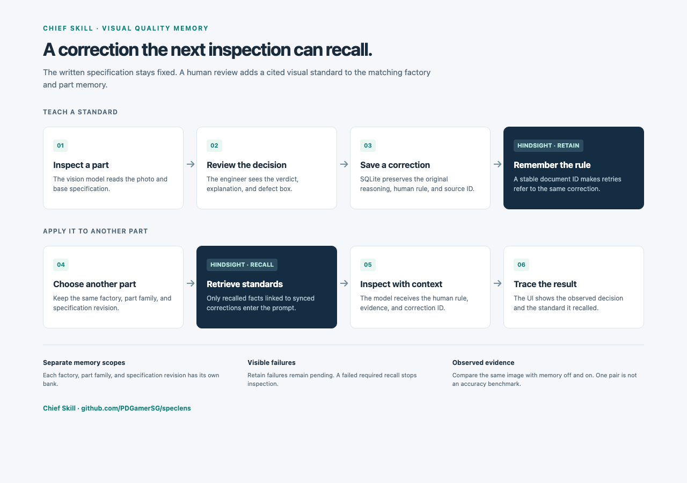
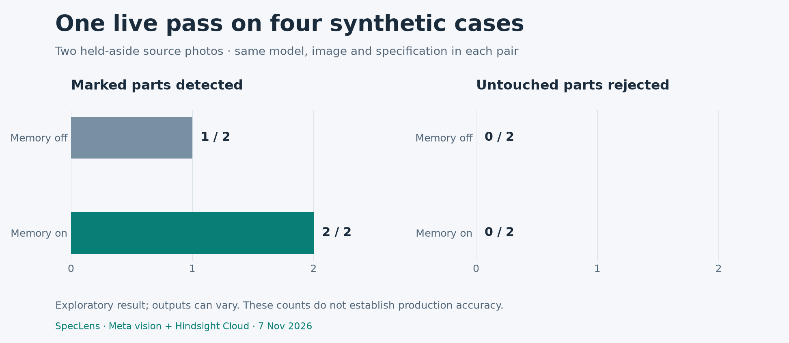

# I Made Inspection Corrections Recallable with Hindsight

A quality engineer can reject a part for a reason that a vision model has just explained away. The useful question is what happens when the next part arrives.

I built SpecLens around that moment. It is a visual inspection workspace where a human correction becomes a quality standard the next inspection can retrieve. The standard carries its source: the part, the model’s original decision, its reasoning, and the engineer who corrected it.

The implementation uses a vision model for inspection and [Hindsight agent memory](https://github.com/vectorize-io/hindsight) for retain, recall, and reflection. SQLite keeps the application’s audit trail. A React interface puts the image, decision, correction form, and recalled standards next to each other.

The difficult part was deciding what a remembered correction should mean.



## A specification leaves room for interpretation

Consider a whole hazelnut with a faint white marking. The specification rejects ink. A model might treat the bright area as natural gloss, particularly when the marking is small or low contrast. A quality engineer may recognize the sharp edges of printed characters immediately.

The bundled examples make this distinction inspectable. They use generated part photos with controlled ink overlays and exact changed-pixel masks. They are synthetic inputs, not production observations. I can identify the pixels added to create the marking without pretending that the examples establish manufacturing accuracy.

A useful correction describes the visual distinction: “Sharp white printed characters on the shell are ink. Reject them as print defects. Broad, smooth natural highlights alone remain acceptable.”

That is more useful than a bare “wrong” button. It tells the next inspection what the engineer meant, while preserving the written specification.

## Keep the mistake and the standard together

An inspection record is immutable. It contains the model verdict, rationale, confidence, image, specification, and recalled sources. A correction is a separate record linked to that inspection.

This matters when reviewing history. Changing a model verdict in place would erase the evidence that a human intervened. I want to see both decisions and understand why they differ.

The correction is saved locally before any network request. It begins as pending. Only a confirmed Hindsight retain changes its status to synced. If the connection fails, the correction stays in SQLite and the interface offers a retry.

The retain item uses a stable document ID:

```python
'document_id': correction['id'],
'update_mode': 'replace',
'metadata': {
    'correction_id': correction['id'],
    'inspection_id': correction['inspection_id'],
    'scope_id': scope.id,
    'reviewer': correction['reviewer'],
},
```

This makes a retry refer to the same correction document. An interrupted write can be attempted again without intentionally creating a second standard under a fresh identity.

The saved content includes the original reasoning and the human rule. It also states that a clarification does not grant permission to bypass other reject clauses. A correction about white ink should not weaken a rule about holes or cracks.

## A factory boundary belongs in memory

A remembered rule needs context. Two factories can have different acceptance criteria. The same factory can inspect several part families. A revised specification can invalidate a rule that used to be appropriate.

SpecLens derives its memory scope from the factory, part family, and exact specification text:

```python
data = json.dumps(
    [self.factory.casefold(), self.part_family.casefold(), self.spec_text],
    ensure_ascii=False,
)
return hashlib.sha256(data.encode()).hexdigest()[:24]
```

The resulting ID names a separate Hindsight bank. Normalizing names prevents capitalization and surrounding whitespace from accidentally splitting a workspace. Keeping the full specification in the identity makes a revision an explicit boundary.

There is a tradeoff: useful standards are not automatically migrated when the specification changes. That is deliberate for this scope. A migration should require review of which rules remain valid. Silent carryover would make it harder to explain why a later part was accepted or rejected.

These are context boundaries within a single-team application. They are not user authorization. Hosting the app remotely still requires an authenticated entry point.

## Recall is a network operation with evidence

The inspection service calls Hindsight recall before invoking the vision model. It then accepts only facts whose source IDs match synced corrections in the active scope:

```python
sources = {
    c['id']: c
    for c in self.store.corrections(scope.id)
    if c['sync_status'] == 'synced'
}
```

The prompt receives the human standard, recalled evidence, and source correction ID. Keeping those fields distinct matters. Hindsight can extract a fact about the original mistake: “The inspector called the white letters gloss.” That sentence describes an error; it is not the rule the engineer wanted to teach.

For every accepted recalled fact, SpecLens attaches the authoritative human rule from the matching audit record. SQLite supplies provenance after Hindsight retrieval. It does not supply a replacement list of corrections when retrieval fails.

A failed required recall stops the inspection with a visible error. Otherwise, a memory outage could look like a successful inspection with nothing useful remembered. Generic HTTP 404 errors are also treated as failures; only a recognized missing-bank response can represent an empty bank.

The [Hindsight documentation](https://hindsight.vectorize.io/) describes the underlying memory operations. In this application, retain stores the correction, recall retrieves relevant facts for another inspection, and reflect summarizes the accumulated quality standards. The summary is a review aid, with the source corrections available underneath it.

## Test transfer on another image

The interface includes a paired comparison. Both arms receive the same image, model, and base specification. One arm receives recalled memory. Call order alternates across comparisons to avoid always running the baseline first.

This makes the difference visible, but it does not establish an accuracy improvement. The model is stochastic. Both arms may reach the same correct decision, the same incorrect decision, or different decisions. The comparison records what happened.

A small implementation detail affects the evidence: image identity uses normalized decoded pixels. Renaming a file or adding PNG metadata does not make a correction image a new test image. Exact reuse is disclosed in the interface.

That still leaves near-duplicates and shared source photos. An independent evaluation must exclude correlated variants manually. For the walkthrough, the teaching image and the next image use different generated source photos. Broader validation needs real parts, held-aside examples, repeated trials, and false-positive controls.

The current automated acceptance scenario demonstrates a narrower contract with simulated external services: a correction is retained, recalled for another part, and passed into a paired inspection. Separate regression checks cover persistence, scope separation, interrupted sync, file serving, and image reuse. Those tests verify the application’s behavior; they are not live vision results.

## The useful unit is a traceable correction

Three decisions shaped the implementation. Preserve the model’s mistake instead of overwriting it. Give memory a context boundary that follows the quality specification. Treat missing recall as a visible failure.

I ran the complete flow against Meta vision and Hindsight Cloud on November 7. The baseline already rejected the white A7 marking. After retaining the standard, the next inspection rejected the C4 marking and explicitly cited the source correction. Reflection returned that standard as well.

The first paired comparison rejected the second marking with memory both off and on. That verified the integration without showing an accuracy gain.

I then ran a separate probe: one teaching photo, two held-aside source photos, a weaker print edit and an untouched control from each. The baseline got three of four verdicts right; the memory-enabled arm got four of four. It detected the faint B2 characters the baseline had called natural texture. Both untouched controls were accepted in both arms.



These are four synthetic cases from two source photos in one pass. They are correlated, hand-selected inputs, and stochastic outputs can change. The raw responses are committed with the evaluation script; they do not establish production accuracy or a stable general improvement.

[Agent memory](https://vectorize.io/what-is-agent-memory) is useful here because the quality judgment belongs to a continuing workflow. A reviewer’s explanation should be available when the next relevant part arrives, with enough context to inspect why it was used.

The [SpecLens repository](https://github.com/PDGamerSG/speclens) contains the inspection desk, Hindsight adapter, durable correction store, synthetic inputs, and verification commands. The central record is small: what the model said, what the engineer corrected, and which later inspection recalled that standard.
