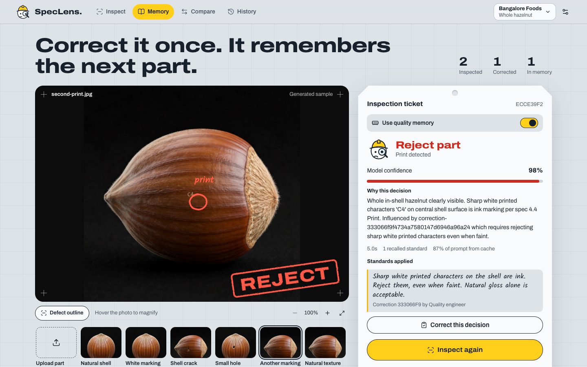
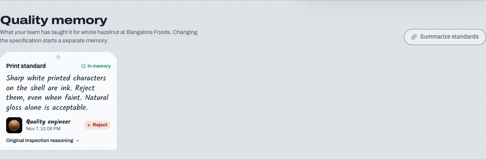
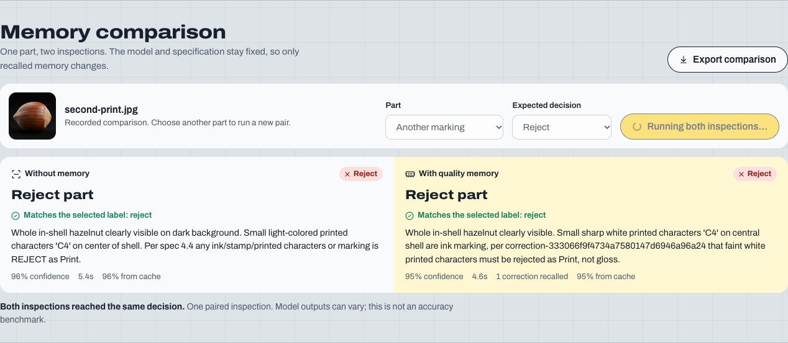
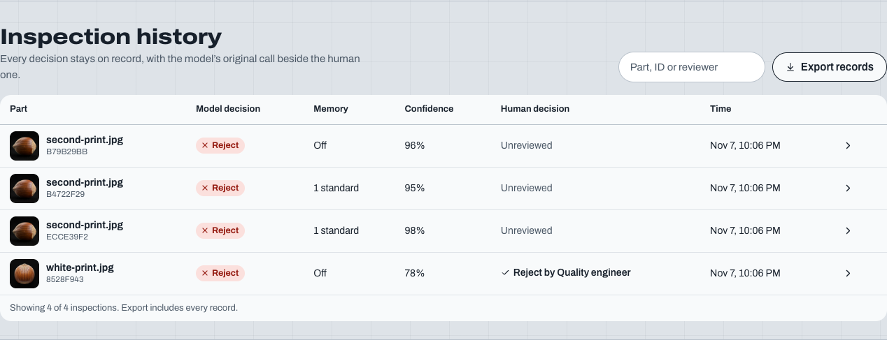
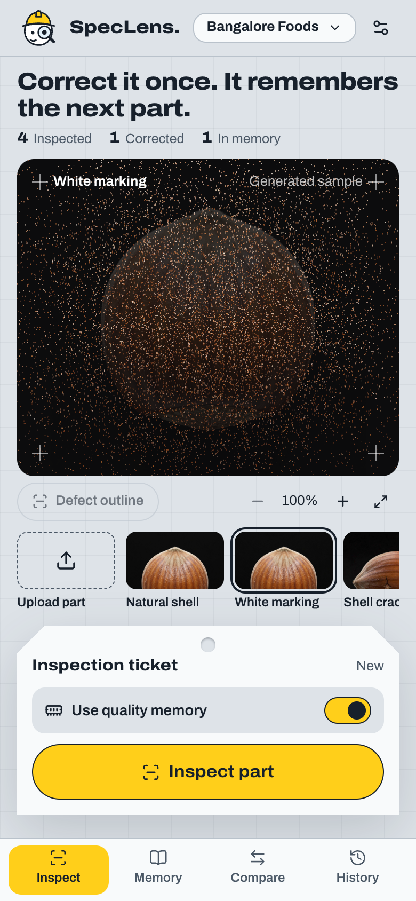

# User guide

What each part of the SpecLens page does, in the order a first-time visitor meets it. The live site is at [speclens.pallabdas.me](https://speclens.pallabdas.me/).

SpecLens is one page at `/`. Four sections stack down the page, and the top bar jumps to each one: **Inspect**, **Memory**, **Compare** and **History** (`frontend/src/workspace/Workspace.tsx:16-21`). The usual loop is:

1. Inspect a part.
2. Correct the decision if it is wrong.
3. Inspect another part and see your standard applied.

The screenshots show synthetic sample parts, not production parts.

## Inspection desk (`/`, Inspect)

  

The counters at the top show **Inspected**, **Corrected** and **In memory** for the current workspace. If corrections are waiting to reach Hindsight, the last label changes to say how many (`frontend/src/workspace/Workspace.tsx:184-188`).

### Choose a part

The row under the photo holds **Upload part** and six generated samples (`frontend/src/workspace/Workspace.tsx:195-202`, `backend/app/workspace/routes.py:34-47`). **White marking** is selected when the page opens (`frontend/src/workspace/Workspace.tsx:75`).

To use your own photo, click **Upload part** or drag a file onto the viewer (`frontend/src/workspace/PartViewer.tsx:93-95`). Use a JPG, PNG or WebP still photo up to 8 MB (`frontend/src/workspace/photo.ts:2-9`). The server also limits photos to 25 megapixels (`backend/app/workspace/routes.py:79`).

### Run the inspection

**Use quality memory** starts on. With it on, SpecLens recalls your standards before it inspects. Turn it off to check the part against the base specification alone (`frontend/src/workspace/Ticket.tsx:46-49`).

Click **Inspect part**. The ticket then shows:

| Item | What it means |
| --- | --- |
| **Accept part**, **Reject part** or **Review part** | The decision. Review means the photo does not clearly show the part (`frontend/src/workspace/Ticket.tsx:13-17`) |
| **Model confidence** | The model's own estimate, not a measured accuracy score (`frontend/src/workspace/Ticket.tsx:61`) |
| **Why this decision** | The model's reason (`frontend/src/workspace/Ticket.tsx:65`) |
| Time, recalled standards, cache share | Seconds taken, how many standards were recalled, and how much of the prompt came from the Model API cache (`frontend/src/workspace/Ticket.tsx:67-71`) |
| **Standards applied** | Each recalled rule, with its correction ID and reviewer (`frontend/src/workspace/Ticket.tsx:72-78`) |

A rejected part with a defect location gets a pencil ring on the photo. **Defect outline** hides or shows it (`frontend/src/workspace/PartViewer.tsx:98`, `frontend/src/workspace/PartViewer.tsx:117`).

### Look closer

Hover over the photo with a mouse to magnify it at 100% zoom (`frontend/src/workspace/PartViewer.tsx:8`, `frontend/src/workspace/PartViewer.tsx:75`). The zoom buttons go from 100% to 200% in 25% steps (`frontend/src/workspace/PartViewer.tsx:119-124`).

While it inspects, the page draws the photo as a moving point cloud. If you have asked your device to reduce motion, or WebGL is not available, it skips the point cloud (`frontend/src/workspace/PartViewer.tsx:31-33`, `frontend/src/workspace/scan.ts:58-60`).

### Correct a decision

Click **Correct this decision** to open **Teach a quality standard** (`frontend/src/workspace/Ticket.tsx:80-82`, `frontend/src/workspace/CorrectionForm.tsx:21`). Fill in:

| Field | Rules |
| --- | --- |
| **Correct decision** | **Accept part** or **Reject part**. If the model accepted the part, this starts on **Reject part**. Otherwise it starts on **Accept part** (`frontend/src/workspace/CorrectionForm.tsx:10`) |
| **Defect class** | Shown for a rejected part: **Ink or print**, **Shell crack**, **Hole**, or **Cut or notch** (`frontend/src/workspace/CorrectionForm.tsx:27`) |
| **What should the inspector learn?** | 10 to 2,000 characters. Describe the visual difference and the standard to apply next time (`frontend/src/workspace/CorrectionForm.tsx:28`) |
| **Reviewed by** | Your name, up to 80 characters. The browser remembers it for next time (`frontend/src/workspace/CorrectionForm.tsx:13`, `frontend/src/workspace/CorrectionForm.tsx:29`) |

Click **Save correction & remember**. SpecLens saves the correction first, then sends it to Hindsight. A notice tells you which happened (`frontend/src/workspace/Workspace.tsx:128`):

- **Correction saved. This standard is now available in Hindsight memory.** It can be recalled from now on.
- **Correction saved here. Memory sync is pending; retry it from Quality memory.** The correction is safe, but Hindsight has not confirmed it yet.

Each inspection takes one correction, and you cannot edit it afterward. To add a further clarification, inspect the part again and correct that inspection (`backend/app/workspace/store.py:115-116`).

## Quality memory (`/`, Memory)

  

Each card is one correction for the current workspace (`frontend/src/workspace/sections.tsx:26-49`). It shows the rule, the reviewer, the source photo and the corrected decision. **Original inspection reasoning** opens the model's first explanation.

- **In memory** means Hindsight confirmed the correction.
- **Sync pending** means it is not in Hindsight yet. The card shows why, with a **Retry sync** button (`frontend/src/workspace/sections.tsx:44-47`).

**Summarize standards** asks Hindsight to write a summary of what it has learned. It needs at least one correction in memory. Check the summary against the cards, because Hindsight wrote it (`frontend/src/workspace/sections.tsx:57-59`).

## Memory comparison (`/`, Compare)

  

A comparison inspects one part twice, once without memory and once with it. The model and specification stay the same, so only recalled memory changes (`frontend/src/workspace/sections.tsx:92`).

1. Pick a part here, or use the part selected on the inspection desk.
2. Optionally set **Expected decision** to **Accept** or **Reject**. Each result then says whether it matches your label (`frontend/src/workspace/sections.tsx:71-74`, `frontend/src/workspace/sections.tsx:107-111`). Sample parts fill this in for you (`frontend/src/workspace/Workspace.tsx:62`).
3. Click **Run comparison**.

Read the result with care:

- It is one paired inspection, and model outputs can vary. It is not an accuracy benchmark (`backend/app/workspace/service.py:90`).
- If the image was used for a correction, or shares a source photo with one, the page says so. Try a different part to check that a standard transfers (`frontend/src/workspace/sections.tsx:119`).
- Each comparison adds two inspections to your history and uses two model calls (`backend/app/workspace/service.py:78-80`).

**Earlier comparisons** lists saved pairs. Open one to see it again. **Export comparison** downloads the open pair as JSON (`frontend/src/workspace/sections.tsx:93`, `frontend/src/workspace/sections.tsx:121-130`). To run a new pair after that, choose a part again.

## Inspection history (`/`, History)

  

The table lists every inspection in the current workspace, newest first, with the model's decision beside the human one (`frontend/src/workspace/sections.tsx:147-161`, `backend/app/workspace/store.py:92`).

- The search box matches the file name, the inspection ID and the reviewer (`frontend/src/workspace/sections.tsx:139`).
- The arrow at the end of a row reopens that inspection on the desk. You can correct it there if it has no correction yet (`frontend/src/workspace/Workspace.tsx:225`).
- **Export records** downloads every record in the workspace as `speclens-inspection-records.json`, even when a search is active (`frontend/src/workspace/Workspace.tsx:224`, `frontend/src/workspace/sections.tsx:165`). The file is built in your browser (`frontend/src/workspace/download.ts:1-12`).

## Workspace settings

Open them with the factory and part name at the top right, or the settings icon next to it. Both are off during an inspection (`frontend/src/workspace/Workspace.tsx:165-166`).

| Field | What it does |
| --- | --- |
| **Factory or workspace** | Up to 100 characters. Starts as `Bangalore Foods` |
| **Part family** | Up to 100 characters. Starts as `Whole hazelnut` |
| **Base quality specification** | Up to 12,000 characters. Starts with the hazelnut specification |

These three fields define a workspace (`frontend/src/workspace/SettingsDialog.tsx:38-41`). Each combination has its own records and memory, and editing the specification starts a separate memory. Letter case in the factory and part names does not matter, but the specification must match exactly (`backend/app/workspace/store.py:32-38`). Your browser stores the current values (`frontend/src/workspace/Workspace.tsx:145`).

The specification changes what the model reads, but the defect classes stay fixed: hole, crack, cut and print (`backend/app/workspace/service.py:39`).

**Server connections** shows whether the vision model and Hindsight are configured, the server's vision spend against its budget, and how much of the prompt the cache has reused (`frontend/src/workspace/SettingsDialog.tsx:42-50`). Keys stay on the server, and this panel cannot change them. **Save workspace** applies your changes, and Escape closes the dialog without saving (`frontend/src/workspace/SettingsDialog.tsx:16`).

## On a phone

  

The page works the same way on a phone. The first screen holds the photo, the part choices and the inspect button (`frontend/tests/output.spec.ts:115`), and the decision scrolls into view when it arrives (`frontend/src/workspace/Ticket.tsx:31-36`).

## Accounts and sign-in

SpecLens has no accounts and no sign-in.

- **On the public site**, a cookie gives your browser a private workspace: your own records, photos and memory (`backend/app/public.py:71-75`). Keep the same browser and cookies to come back to your history. Clearing cookies or changing browser starts a new workspace, and the old one cannot be recovered. The cookie lasts 30 days from when it was set, and return visits do not renew it (`backend/app/public.py:96-98`). The site allows 30 POST requests per browser per hour and 120 per IP address.
- **On a local install**, everyone who can reach the server shares one workspace set (`backend/app/public.py:29-30`).

Your browser also stores two conveniences in local storage: your workspace fields (`speclens-scope`) and your reviewer name (`speclens-reviewer`).

If something goes wrong, the page shows the reason in a red alert. See [troubleshooting](TROUBLESHOOTING.md).
