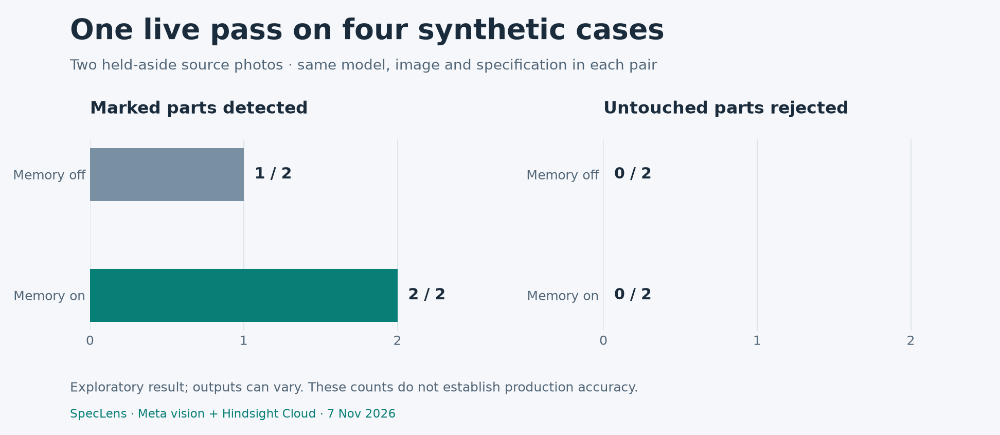

# Verification record

## Automated application checks

The current SpecLens release passed **74 Python tests**, **24 browser scenarios**, the production build, and clean lint. The same checks run in CI. The two new backend regressions verify that the renamed browser cookie preserves existing visitor records and recovers a valid legacy session when the new cookie is invalid.

The [GitHub run for 4bd3a5e](https://github.com/PDGamerSG/speclens/actions/runs/42385604175) passed 63 Python tests and 14 browser scenarios before the final mobile-history regression was added. [Current main checks](https://github.com/PDGamerSG/speclens/actions/workflows/ci.yml) run the full suite. These tests simulate external vision and Hindsight calls.

The browser suite covers valid uploads, correction and history exports, image zoom and defect outlines, keyboard-accessible persistent settings, saved labeled and unlabeled comparisons, mobile navigation, startup recovery, and interrupted memory sync. Public boundary tests also cover visitor isolation, HTTPS cookies, export impersonation, and stopping oversized streamed uploads before full multipart parsing.

The macOS setup script completed successfully. The Docker image built on Linux ARM64 and served its UI, status, and sample images. Direct requests for the SQLite database and ledger returned 404. A missing model key produced the expected 503 setup response.

## Public deployment

The one-page release passed all 11 steps of `frontend/scripts/live-smoke.mjs` against the public site on November 7, 2026, with real Meta vision and Hindsight calls. The run covered inspection, a synced correction, a recalled citation on a different part, the Hindsight summary, an upload, a comparison, export, reload, phone layout, and a second browser that could not read the first browser's records. A separate public upload of a diagram returned **Review part** with the reason shown, and the page logged no console errors or failed requests.

The notes below describe the earlier release. Its recorded demo shows the previous interface.

The canonical public app is [SpecLens](https://speclens.pallabdas.me). The [Vercel release record](evidence/vercel-release.json) covers the current frontend deployment, API proxy, and 11 passing live scenarios with five real vision calls. The [custom-domain record](evidence/custom-domain.json) covers DNS, HTTPS, release matching, and API/media checks on that hostname. The [SpecLens release record](evidence/speclens-release.json) verifies the application on its original public host with real Meta and Hindsight calls: sample and uploaded-photo inspections, retain, cited recall, reflection, unlabeled comparison export, history, viewer controls, settings, mobile behavior, and isolation from a second browser. All eleven live scenarios passed. Existing visitor history also remained readable after the cookie-name migration on the earlier hostname. A further container restart preserved the current five inspections, correction, comparison, and private photos; Hindsight still recalled the correction.

The [recorded demo](submission/SpecLens-demo-1080p.mp4) uses four additional real vision calls. `ffprobe` verifies H.264 video at 1920×1080, AAC audio, an English subtitle track, and a duration of 207.775 seconds. Its generated narration reports the actual model verdicts; it makes no general accuracy claim.

The [initial public-release record](evidence/public-release.json) documents the earlier HTTPS deployment on the same persistent server. Its raw hostnames and historical facts are preserved. The observations below describe that recorded run.

Five real vision calls verified the sample baseline, a human correction retained by Hindsight, cited recall on a different sample, an uploaded-photo inspection, and a paired comparison. Hindsight also returned a standards summary. Both comparison arms rejected the marked part; this check establishes integration, not an accuracy gain.

The deployed browser check verified history search and complete exports, reopening saved records, an unlabeled comparison export, zoom, defect outlines, settings focus and Escape, and mobile navigation. Its first run found document overflow in populated mobile history. A focused regression reproduced it; the fix keeps the screen-reader column label within the table's scroll container. Resumed live checks passed at a 390-pixel viewport without making another vision call.

A second browser with identical factory settings could not read the first browser's records, five private images, corrections, or standards. HTTPS cookies are Secure and HttpOnly. Foreign-origin writes, private files, unused legacy APIs, invalid images, and oversized streamed uploads were checked on the actual public endpoint.

After an explicit application-container restart, all five inspections, one correction, one comparison, and five private photos remained available. Hindsight still recalled the retained correction. SQLite, media, and the usage ledger use a persistent Docker volume.

Reproduce the billable public browser check with:

```bash
node frontend/scripts/live-smoke.mjs
```

It makes five vision calls and writes reports under gitignored `var/checks/`. Its storage-state file is a session credential, saved with mode `0600`; keep it private. The script supports resuming browser checks from that state without another vision call. See [deployment and recovery](deployment.md) for server operations.

## Live external services

The [sanitized integration record](evidence/live-integration.json) comes from an actual Meta vision and Hindsight Cloud run on November 7, 2026. It confirms:

- A live vision response with memory disabled.
- A confirmed retain and recall linked to the stable correction ID.
- A later inspection of a different source photo that cited the correction.
- A Hindsight standards reflection.
- A paired comparison with identical image, model, and base specification.
- Four durable inspection records and the linked correction.

Both comparison arms rejected the marked part. This check proves live integration behavior; it does not demonstrate a learning improvement or establish accuracy on factory data. Inputs were synthetic. The report separates vision spend from Hindsight billing.

## Live memory ablation

The [complete four-case record](evidence/memory-ablation.json) uses a separate teaching source (01) and two held-aside source photos (02 and 03). Each test photo contributes one faint-print image and one untouched control. Both comparison arms use the same normalized pixels, model, and base specification; call order is alternated by the service. A human-written rule is retained once, then recalled for each memory-enabled inspection.

| Observed count | Memory off | Memory on |
|---|---:|---:|
| Correct verdicts | 3/4 | 4/4 |
| Marked parts detected | 1/2 | 2/2 |
| False alarms on untouched controls | 0/2 | 0/2 |

The changed decision concerned the faint B2 marking on source 03. Without memory, the model described natural stripes and gloss. With memory, it identified the faint printed characters and cited the retained correction. See the [actual comparison screenshot](screenshots/comparison-live.png).

This is one exploratory pass on four synthetic cases from two correlated source-photo groups, not evidence of production accuracy or a stable causal effect. No repeated-run confidence estimate is available. The earlier integration check correctly caught its marked sample in both arms.



## Band Desktop

Official Band Desktop 0.4.18 was installed with a verified application signature. `band doctor` reported a reachable daemon, a connected account, and three connected configured agents. The app was opened and its account/agent connections checked. This record does not claim that the implementation was authored through Band.
